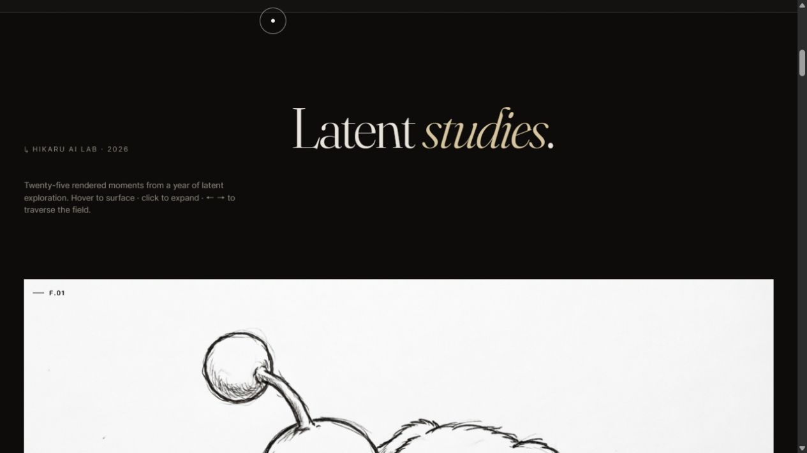

# Hikaru — Latent Studies · Vol. 026

Twenty-five generative image studies from Hikaru's 2026 AI image lab, presented as an interactive editorial gallery.

光曜町 AI 影像實驗：以 25 幅生成式影像研究，探索品牌視覺與互動呈現。

[**Explore the live gallery ↗**](https://hikaru-tw.github.io/hikaru-vol-026/) · [Hikaru Digital Marketing](https://www.hikaru.com.tw/)

[](https://hikaru-tw.github.io/hikaru-vol-026/)

## About the project

Latent Studies brings together generative imagery, typography, motion, and an image lightbox in a static website. Browse the studies, select an image to expand it, and use the left and right arrow keys to move through the collection.

[Hikaru — 光曜町](https://www.hikaru.com.tw/) is a Taipei-based digital agency combining brand strategy, creative production, digital marketing, and AI applications since 2010.

## Stack

Plain HTML, CSS, and JavaScript. No build step is required.

| File | Purpose |
| --- | --- |
| `index.html` | Page structure and gallery content. |
| `styles.css` | Layout, typography, and animation styles. |
| `script.js` | Loading, scrolling, gallery, lightbox, and cursor interactions. |
| `image/` | Gallery assets, F.01–F.25. |

Typography: Fraunces, Inter Tight, Noto Serif TC, and Zen Old Mincho, served through Google Fonts.

## Run locally

```bash
git clone https://github.com/Hikaru-tw/hikaru-vol-026.git
cd hikaru-vol-026
python -m http.server 8000
```

Open [http://localhost:8000](http://localhost:8000). You can also serve the folder with your preferred static web server.

## Deployment

Pushes to `main` deploy automatically to GitHub Pages through [`.github/workflows/pages.yml`](.github/workflows/pages.yml).

## Credits

- Studio: [Hikaru · 光曜町](https://www.hikaru.com.tw/).
- Built by [@eryet](https://github.com/eryet).

© 光曜町數位行銷 · 2026 · Visual Index № 026
